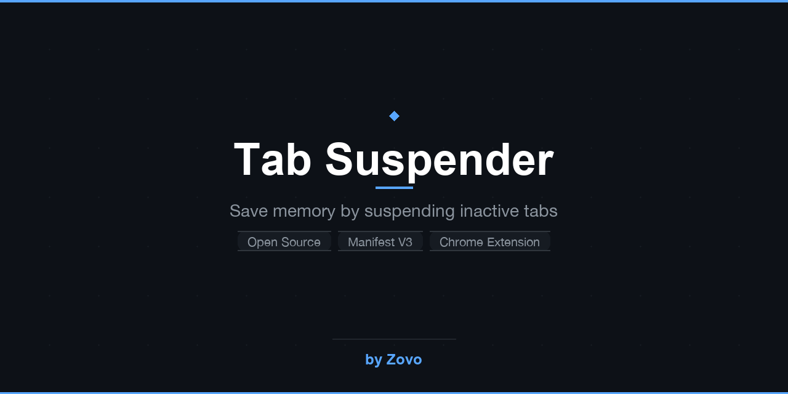

# Tab Suspender — Free Open Source Chrome Extension

> An MIT-licensed Manifest V3 Chrome extension that suspends inactive tabs to free memory. No analytics, no network requests, no third-party code.

<p align="center">
  
</p>

<p align="center">
  <a href="https://chromewebstore.google.com/detail/tab-suspender-pro-save-me/ofgncemnlblfnocjbojdhamacfffcpnm"></a>
  <a href="https://github.com/theluckystrike/tab-suspender-chrome-extension/releases/latest"></a>
  
  
</p>

## ⚡ Why Tab Suspender?

When The Great Suspender was removed from the Chrome Web Store for containing malware, millions of users were left without a reliable tab suspension tool. Many "replacements" appeared, but few were open source, and even fewer were built on modern Manifest V3.

**Tab Suspender** is the open source Great Suspender alternative you've been looking for. Built from the ground up with Chrome's latest Manifest V3 architecture, it automatically suspends inactive tabs to free up memory — without compromising your privacy or security.

Unlike closed-source alternatives, every line of code is right here for you to inspect. No hidden trackers. No data collection. No malware. Just a clean, efficient tab suspender that does exactly what it promises.

## ✨ Features

- **Auto-Suspend Inactive Tabs** — Automatically suspends tabs after a configurable period of inactivity (5 minutes to 24 hours), freeing up RAM and CPU resources
- **Instant Tab Restoration** — Click any suspended tab or press any key to instantly restore it to its original state
- **Smart Domain Whitelist** — Protect important sites like Gmail, Google Calendar, and Google Docs from ever being suspended, with an easy-to-manage whitelist
- **Audio Tab Protection** — Tabs playing music or video are never suspended, so your Spotify, YouTube, and podcast streams stay uninterrupted
- **Unsaved Form Protection** — Keeps tabs with detected unsaved text, checkbox, or dropdown edits from being suspended by the background. Enabled by default; detection is best-effort.
- **Pinned Tab Protection** — Pinned tabs are never suspended by default, keeping your most important tabs always ready
- **Active Tab Protection** — The tab you're currently viewing is never suspended
- **Suspend & Restore All** — One-click buttons to suspend all inactive tabs at once or restore all suspended tabs simultaneously
- **Memory Savings Dashboard** — Track how much memory you've saved today and over time with a detailed statistics dashboard and historical charts
- **Tab Search & Filtering** — Quickly find any tab by title or URL, and filter by status (active, idle, suspended)
- **Keyboard Shortcuts** — Power-user shortcuts for fast tab management:
  - `Alt+S` — Suspend current tab
  - `Alt+Shift+S` — Suspend all other tabs
  - `Alt+R` — Restore all tabs
  - `Alt+W` — Whitelist current site
- **Context Menu Integration** — Right-click any page to suspend, restore, or whitelist directly from the context menu
- **Settings Import/Export** — Back up and restore your configuration across devices with JSON import/export
- **Beautiful Suspended Tab Page** — Suspended tabs display the original favicon, page title, memory saved, and time suspended with a clean, branded design
- **Badge Counter** — See the number of currently suspended tabs right on the extension icon
- **Onboarding Flow** — Guided setup for new users with interactive demo and quick configuration

## 📦 Install

### Chrome Web Store

👉 **[Tab Suspender Pro on the Chrome Web Store](https://chromewebstore.google.com/detail/ofgncemnlblfnocjbojdhamacfffcpnm)** — one-click install, automatic updates

The Chrome Web Store build is Zovo's Tab Suspender Pro. It ships from a separate codebase, so its features and version numbers differ from this repository. Its core features are free; see [Pro Version](#-pro-version) below.

### Install this repository (unpacked)

1. Clone this repository:
   ```bash
   git clone https://github.com/theluckystrike/tab-suspender-chrome-extension.git
   ```
2. Open Chrome and go to `chrome://extensions/`
3. Enable **Developer mode** in the top right
4. Click **Load unpacked** and select the `src/` directory

## 🔒 Privacy & Security

Tab Suspender is committed to your privacy:

- **100% Open Source** — Every line of code is publicly auditable
- **No Data Collection** — We don't collect, store, or transmit any of your data
- **No Analytics** — No tracking scripts, no telemetry, no phone home
- **No Remote Code** — Everything runs locally in your browser
- **No External Dependencies** — Zero third-party libraries or CDN resources
- **Manifest V3** — Built on Chrome's latest, most secure extension platform

See our [Security Policy](SECURITY.md) for more details.

## 🆚 Comparison

See [COMPARISON.md](COMPARISON.md) for a comparison with The Great Suspender, Auto Tab Discard, The Marvellous Suspender and OneTab.

## 🚀 Pro Version

The Chrome Web Store build, **[Tab Suspender Pro](https://chromewebstore.google.com/detail/ofgncemnlblfnocjbojdhamacfffcpnm)**, lists these features for Zovo members:

- A custom suspend timer from 1 to 120 minutes
- An unlimited whitelist
- URL wildcard patterns, such as `https://docs.google.com/*`

## 🤝 More from Zovo

| Extension | Description | Install |
|-----------|-------------|---------|
| JSON Formatter Pro | Format, validate, and beautify JSON in your browser | [Chrome Web Store](https://chromewebstore.google.com/detail/json-formatter-pro/gbnadjkeegkhbcoeaeaoedpojlcknnhp) |
| Cookie Manager | View, edit, export, and manage browser cookies | [Chrome Web Store](https://chromewebstore.google.com/detail/cookie-manager/ijolfnkijbagodcigeebgjhlkdgcebmf) |
| Regex Tester Pro | Test and debug regular expressions in your browser | [Chrome Web Store](https://chromewebstore.google.com/detail/regex-tester-pro-by-zovo/laljckjnohfcbhmlehjkcppkdfibldad) |
| Clipboard History Pro | Never lose copied text again | [Chrome Web Store](https://chromewebstore.google.com/detail/clipboard-history-pro/ddmidpneacclepjmdjibmcdijedgdidf) |
| Session Manager Pro | Save and restore browser sessions | [Chrome Web Store](https://chromewebstore.google.com/detail/session-manager-pro-by-zo/mhbfbnmokccombamjdflafbakdlnehlh) |

## ⭐ Support

If this extension helps you, please:

- ⭐ **Star this repo** — helps others find it
- 📝 **[Leave a review](https://chromewebstore.google.com/detail/tab-suspender-pro-save-me/ofgncemnlblfnocjbojdhamacfffcpnm)** on the Chrome Web Store
- 📢 **Share with colleagues** who have too many tabs open
- 🐛 **[Report bugs](https://github.com/theluckystrike/tab-suspender-chrome-extension/issues)** to help improve it

## 📄 License

MIT License — free to use, modify, and distribute. See [LICENSE](LICENSE) for details.

---

Made with ❤️ by [Zovo](https://zovo.one) — Open source Chrome extensions for developers and productivity

---
**Offline IDE Viewers by Zovo:** Browse 146 local-first extensions for Cursor, Windsurf, and VS Code at [vscode.zovo.one](https://vscode.zovo.one/) and read format guides at [vscode.zovo.one/guides/](https://vscode.zovo.one/guides/).
